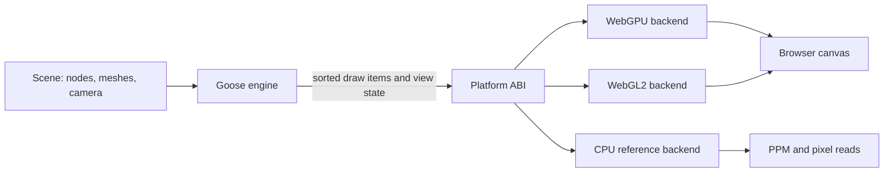
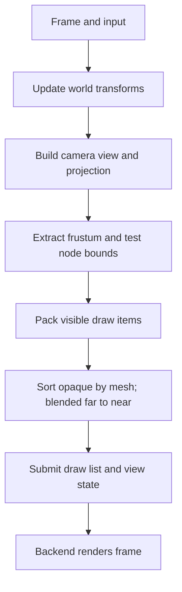

# Frame and backend overview

The engine prepares a backend-independent draw list; the selected backend owns
presentation. The browser's default page chooses WebGPU at startup and falls
back to WebGL2 if initialization fails. The native application uses the CPU
backend for headless rendering and pixel checks.

Each frame updates scene state before visibility and sorting. Backends consume
the resulting order; the key explains the order and is not a request to sort
again. Shadow-enabled frames may also submit off-camera shadow casters.

## How it works

**Everything is an arena.** There is no heap in Goose, so geometry lives in two
  global arrays — all vertices, all indices — and each mesh is a small record
saying where its run lies inside them. Released spans can be reused by ordinary
and asset meshes; array capacity is retained. The scene is a third array of
nodes. `node_add` returns an index and `node` gives access to the record;
checked node handles also record the generation and scene epoch so reuse can be
detected. References and raw indices must not outlive the node they identify.

**One pass per frame.** `frame(dt)` samples input, multiplies out each node's
world matrix by walking its parent chain, builds the view-projection matrix,
derives the six frustum planes from it (Gribb–Hartmann), then walks the nodes:
cull against the planes (one p-vertex dot product per plane), pack a `DrawItem`
for what survives, sort the list, and hand it to the backend in a single call.

**The sort is the batching.** Opaque items are keyed by mesh id, so a backend
sees runs of the same mesh back to back, where a driver saves state changes.
Blended items get keys above 1000000 and are ordered far to
near, so they are drawn after everything opaque and read the depth they should.

**One seam, multiple backends.** A `DrawItem` is packed data: an `i32` mesh id, two
`Mat4`s, colour, shading parameters, the sort key, texture IDs, alpha settings,
a double-sided flag, twelve texture-coordinate transforms, clearcoat and sheen factors and maps, and per-material environment intensity, 653 bytes. A
`Vertex` is 120 bytes, including eight UV sets, tangent and colour. Its
`ViewState` is 1268 bytes and includes eight extra lights, render-target selection, dimensions and
the shared camera view-projection matrix.
`g3p_draw_frame` hands the backend a slice
of them plus the frame's `ViewState`, and `platform/g3_abi.h`
static-asserts every offset, so the Goose and C sides cannot drift apart
silently.

The CPU backend is not a toy: its `shade()` is the same shader as
`platform/g3_web.c`'s GLSL, term for term, driven by the same matrices. That is
what makes the headless path a real test of the engine rather than a second
implementation that agrees with itself. The WebGPU backend renders the same
built-in scene through its WGSL path, while extended material and post-processing
APIs remain WebGL2-only. CPU and WebGL2 frame statistics match exactly (11 draws,
6884 triangles above). The CPU renderer is threaded,
too: triangles are transformed once into a display list, then 8-row blocks are
rasterized in parallel by workers that claim them atomically — 4.65× on eight
logical cores, with byte-identical output.
